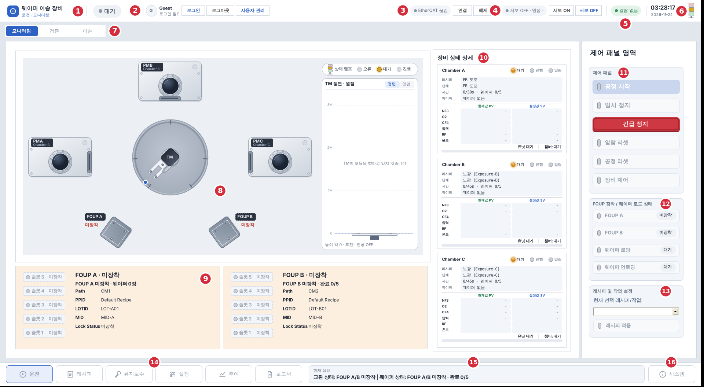

# Semiconductor UI - 웨이퍼 이송 장비 제어 HMI 🖥️⚡

> 📂 [포트폴리오 (Notion)](https://iced-tarsier-455.notion.site/350af40f5e6680d19f93f1653925a3b8) · 🎥 [시연 영상](https://youtu.be/_ko-Cr73uJA)
>
> 📘 처음 쓰는 사람을 위한 사용 안내: [사용자 가이드](사용자_가이드/README.md)

EtherCAT(IEG3268) 실장비와 연결해 **웨이퍼 이송 로봇(TM)과 챔버 3개(Chamber A/B/C), FOUP 2개**를 제어하는 C# WinForms HMI입니다.
FOUP A의 웨이퍼를 레시피 순서대로 챔버에 넣고 빼서 FOUP B로 옮기는 전 과정을 자동으로 돌리고, 장비가 없을 때는 시뮬레이션 모드로 같은 순서를 화면에서 확인할 수 있습니다.

실제 장비를 움직이는 프로그램이라, 기능을 늘리는 것보다 **장비와 웨이퍼를 망가뜨리지 않는 안전 장치**를 먼저 만들고 실장비에서 하나씩 확인했습니다.



---

## 🛡️ 실장비 안전 장치

| 안전 장치 | 하는 일 | 코드 |
| --- | --- | --- |
| 화면 긴급 정지 | 두 축 서보를 바로 끄고, 장비를 움직이는 출력(도어·실린더)과 웨이퍼를 놓치게 하는 출력(진공 OFF·배기 ON)을 막습니다. 램프와 진공 유지 출력만 허용합니다. | `Hardware/EmergencyStopPolicy.cs` |
| 회전·실린더 인터락 | 실린더가 후진 위치가 아니면 회전(축2) 이동과 회전 원점복귀를 보내지 않고, 회전이 끝났다고 확인되기 전에는 실린더 전진을 보내지 않습니다. 상하(축1)는 웨이퍼를 집고 놓아야 하므로 막지 않습니다. | `Hardware/TmMotionInterlock.cs` |
| 원점복귀 순서 | 실린더 후진 상태에서만, 상하(축1) 원점복귀가 끝난 뒤에 회전(축2) 원점복귀를 합니다. 두 축을 동시에 돌리지 않습니다. | `Hardware/ResetHomingSequence.cs` |
| 서보 알람 감시 | 드라이브 알람이 새로 생기면 긴급 정지와 같은 경로로 멈춥니다. | `Hardware/ServoFaultMonitor.cs` |
| 서보 OFF 후 재원점 | 서보를 껐다 켜거나 긴급 정지·서보 알람이 난 뒤에는 앱이 원점복귀를 다시 할 때까지 이동 명령을 거부합니다. | `Controllers/TmHardwareController.cs` (`RehomeRequired`) |
| 공정 중 조작 잠금 | 공정(원점복귀 포함) 중에는 수동 장비 제어, 시작·리셋, 서보 ON/OFF, 로그아웃, 통신 해제, 프로그램 종료를 막습니다. | `Form1.cs` (`IsProcessActiveOrStarting`) |
| 통신 감시 | EtherCAT 통신 이상이 연속으로 나오면 경고와 요약 로그를 남깁니다. 지금은 1단계라 장비를 멈추지는 않습니다. | `Hardware/EthercatCommWatchdog.cs` |
| 긴 동작은 백그라운드 | 서보 ON·원점복귀는 백그라운드에서 돌려, 그동안에도 화면 긴급 정지를 누를 수 있습니다. | `Hardware/HardwareOperation.cs` |

> ⚠️ 레시피·유지보수·설정·추이·보고서 창은 아직 모달 창이라, 떠 있는 동안에는 메인 화면의 긴급 정지를 누를 수 없습니다. 장비가 움직이는 중에는 열지 마세요. 장비에는 하드웨어 비상정지 입력이 배선되어 있지 않습니다.

## 🧰 운영 기능

| 기능 | 내용 | 코드 |
| --- | --- | --- |
| 자동 공정 | FOUP A → Chamber A → B → C → FOUP B (2차 노광 ON) 또는 A → B/C 중 빈 곳 → FOUP B. FOUP당 최대 5장. | `Controllers/TransferController.cs` (`TmPhase`), `Helpers/Form1TmProcessor.cs` |
| 로그 | 하루 단위 CSV 로그 파일 (`문서\SemiconductorUi_Logs\Daily`) | `Services/DailyLogFileWriter.cs` |
| 알람 이력 | 알람 발생·해제 기록과 조회 창 | `Services/AlarmHistoryService.cs` |
| 유지보수 카운터 | 실린더 전진·도어 열림·진공·배기 동작 횟수와 두 축 이동·원점복귀 횟수 누적, 점검 주기 경고 | `Services/MaintenanceCounterService.cs` |
| 변경 이력 | 티칭값·속도·레시피·알람 기준·사용자 변경 기록 | `Services/ChangeHistoryService.cs` |
| 설정 백업 | 매일 자동 백업, 수동 백업, 다음 시작 때 복원 | `Services/SettingsBackupService.cs` |
| 웨이퍼 이력 | 웨이퍼별 공정 경로와 시간 기록 | `Services/WaferHistoryService.cs` |
| 추이 | 챔버 A/B/C 온도·압력 그래프 (공정 중 1초마다 기록) | `Forms/TrendForm.cs` |
| I/O 모니터 | 디지털 입출력과 서보 상태 실시간 확인 | `Forms/IoMonitorForm.cs` |
| 티칭·속도 | 위치 티칭과 서보 속도 설정 | `Forms/TeachingPositionForm.cs` |
| 사용자 | 관리자/작업자 2단계 권한, 로그인 필요 기능 잠금 | `Forms/UserManagementForm.cs` |

---

## ▶️ 빌드와 실행

### 필요한 것
- Windows, Visual Studio 2022 (".NET 데스크톱 개발" 워크로드)
- .NET Framework 4.7.2
- `IEG3268_Dll.dll` (저장소 루트에 포함, 프로젝트가 `..\IEG3268_Dll.dll`로 참조)
- 실장비로 돌릴 때만: Hilscher cifX 드라이버(`cifx32dll.dll`)와 EtherCAT 장비

### 빌드
1. `SemiconductorUi/SemiconductorUi.sln`을 Visual Studio로 엽니다.
2. `빌드 → 솔루션 빌드`. 결과는 `SemiconductorUi/bin/Debug/SemiconductorUi.exe`입니다.

### 실행
- **시뮬레이션 (장비 없음)**: 프로그램을 켜고 EtherCAT `연결`을 누르지 않은 채 로그인 → FOUP 장착 → 레시피 적용 → 시작. 장비는 움직이지 않고 화면에서만 공정이 진행됩니다. 처음이라면 [01_처음_시작하기.md](사용자_가이드/01_처음_시작하기.md)를 따라 해 보세요.
- **실장비**: 로그인 → 위쪽 `연결` → 실린더 후진 확인 → FOUP 장착·웨이퍼 로딩 → 레시피 적용 → 공정 시작. 연결 후 첫 공정은 서보 ON과 원점복귀(상하 먼저, 그다음 회전)부터 자동으로 합니다. 그 전에 [02_멈춤과_알람.md](사용자_가이드/02_멈춤과_알람.md)를 꼭 읽으세요.

### 주요 설정 (`SemiconductorUi.exe.config`)
코드를 고치지 않고 장비에 맞게 바꿀 수 있는 값입니다. 전체 목록은 `SemiconductorUi/App.config`에 있습니다.

| 키 | 기본값 | 뜻 |
| --- | --- | --- |
| `ServoDefaultVelocity` / `MaxVelocity` / `Acceleration` | 1000000 | 서보 이동 속도. 느리게 하려면 세 값을 함께 낮춥니다. |
| `ServoInPositionToleranceAxis1` / `Axis2` | 1000 | 목표 위치에서 이만큼 안에 머무르면 이동 완료로 봅니다 (0이면 드라이브 완료 신호만 사용). |
| `ServoInPositionHoldMs` | 300 | 위 허용 범위 안에 머물러야 하는 시간 |
| `DoorOpenWaitMs` / `DoorCloseWaitMs` | 2200 / 2100 | 도어 열림·닫힘 대기 시간 (도어 센서가 없어 시간으로 기다림) |
| `HardwareModeTickMilliseconds` | 50 | 실장비 모드 공정 루프 주기 |
| `MaxFoupCapacity` | 5 | FOUP당 웨이퍼 수 |
| `EthercatWatchdogIntervalMs` / `FailCount` | 1000 / 2 | 통신 감시 주기와 "이상" 판정 연속 횟수 |
| `LogRetentionDays` / `AlarmHistoryRetentionDays` | 90 / 365 | 로그·알람 이력 보관 기간 |

### 테스트
`SemiconductorUi.Tests` (MSTest, 테스트 156개)를 Visual Studio `테스트 탐색기`에서 실행합니다. 안전 규칙(긴급 정지, 인터락, 원점복귀 순서, 서보 알람, 통신 감시)은 장비 없이 가짜 시계·가짜 장치로 시험합니다.

---

## 📐 구조

화면(Form1)에 몰려 있던 코드를 계층별로 나누는 중입니다. 안전 규칙과 운영 기능은 `Hardware/`와 `Services/`로 분리해 테스트를 붙였고, **공정 순서 판단은 아직 `Form1.cs`에 남아 있어** 다음 분리 대상입니다.

```
화면        Form1 (partial), Forms/, Controls/, EventHandlers/
  │
공정·상태   Controllers/ (TransferController TmPhase 상태 머신, ChamberController, TmHardwareController)
            Helpers/ (Form1TmProcessor 공정 진행, Form1UiUpdater 화면 갱신, AlarmManager)
  │
서비스      Services/ (로그, 알람·변경·웨이퍼 이력, 유지보수 카운터, 백업, HardwareManager)
            Repositories/ (사용자·레시피·설정 XML)
  │
장비        Hardware/ (IEthercatDevice → Ieg3268Device → IEG3268 DLL, 안전 규칙)
```

### 폴더
```
SemiconductorUi/
├── Hardware/       # 장비 창구(IEthercatDevice)와 안전 규칙: 긴급 정지, 인터락, 원점 순서, 서보 알람, 통신 감시
├── Controllers/    # TM 이송 상태 머신(TmPhase), 챔버, TM 하드웨어 동작
├── Services/       # 로그, 이력(알람·변경·웨이퍼), 유지보수 카운터, 설정 백업, HardwareManager
├── Repositories/   # 사용자·레시피·설정 XML 저장
├── Helpers/        # 공정 진행(Form1TmProcessor), 화면 갱신, 알람 판정, 캔버스 그리기
├── Controls/       # 장비 캔버스(TM·챔버·FOUP), 상단 바, PM 상태 패널
├── Forms/          # 레시피, 티칭, 유지보수, 이력, I/O 모니터, 추이, 사용자 관리 창
├── EventHandlers/  # 버튼·타이머·로그인·네비게이션 이벤트
├── Interfaces/, Models/, ViewModels/
├── Form1*.cs       # 메인 화면 (partial로 기능별 분리)
└── App.config      # 장비 타이밍·속도·알람 기준 설정
SemiconductorUi.Tests/   # MSTest 단위 테스트
사용자_가이드/            # 처음 쓰는 사람용 안내서
코드_상세_설명_*.md       # 주요 클래스 설명
```

---

## ⚙️ 장비 조건과 한계

이 장비에 실제로 있는 입력은 **실린더 전진·후진 센서**와 **두 축 서보 상태·위치**뿐입니다. 그래서 다음은 센서 대신 시간이나 화면 입력으로 처리합니다.
- 도어 열림·닫힘: 센서 없음 → 설정한 시간만큼 기다림
- 진공 압력, 웨이퍼 유무, FOUP 장착: 센서 없음 → 화면 상태와 버튼으로 관리
- 챔버 온도·압력: 장비와 연결되어 있지 않음 → 화면 값은 시뮬레이션
- 하드웨어 비상정지 입력, Z축 브레이크: 없음 → 긴급 정지(서보 OFF) 때 Z축이 내려앉을 수 있음

---

## 🤝 개발 방식

- 기능 하나 = 브랜치 하나 = PR 하나. 장비 동작이 바뀌는 PR에는 실장비 확인 체크리스트를 붙이고, 실장비에서 확인한 뒤 다음 변경으로 넘어갑니다.
- 시뮬레이션 모드와 단위 테스트로 먼저 확인하고, 실장비는 저속·웨이퍼 없이 먼저 돌려 봅니다.
