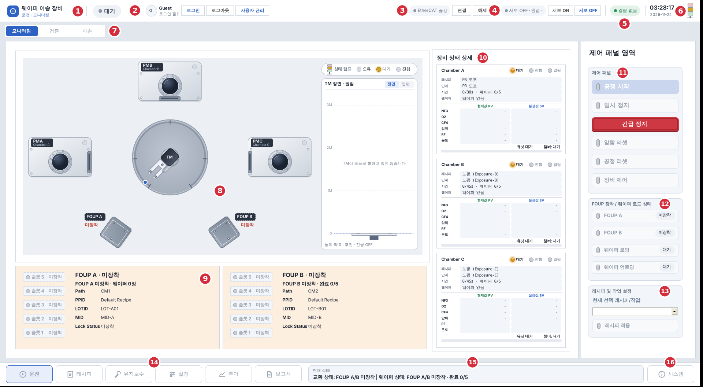

# 01. 처음 시작하기

이 문서를 따라 하면 다음을 할 수 있습니다.
- 화면 각 부분이 무엇인지 안다.
- 시뮬레이션으로 첫 공정을 끝까지 돌려 본다.
- 실제 장비로 공정을 돌리고 끝낸다.

> 처음에는 **3장(시뮬레이션)**까지만 해 보세요. 장비는 움직이지 않으니 버튼을 마음껏 눌러 봐도 됩니다.
> 실제 장비로 돌리기(4장) 전에는 [02_멈춤과_알람.md](02_멈춤과_알람.md)를 꼭 읽으세요.

---

## 1. 이 프로그램이 하는 일

장비는 위에서 내려다본 모양으로 화면 가운데에 그려져 있습니다.
- 가운데: **TM**(이송 로봇). 돌고, 위아래로 움직이고, 팔(실린더)을 내밀어 웨이퍼를 집습니다.
- 둘레: **Chamber A / B / C**(공정 챔버). 9시, 12시, 3시 방향에 있습니다.
- 아래: **FOUP A**(웨이퍼를 꺼내는 곳, 7시)와 **FOUP B**(다 끝난 웨이퍼를 넣는 곳, 5시). FOUP 하나에 웨이퍼는 최대 5장입니다.

공정 버튼을 누르면 프로그램이 웨이퍼를 아래 순서로 옮깁니다.

```
FOUP A → Chamber A → Chamber B 또는 C → FOUP B
```

- 레시피에서 **2차 노광**을 쓰면 `Chamber A → B → C` 순서로 모두 거칩니다.
- 쓰지 않으면 B와 C 중 비어 있는 쪽으로 갑니다.
- 각 챔버에 머무는 시간은 레시피에 정해져 있습니다.

---

## 2. 화면 둘러보기



> 그림은 시험용 PC에서 찍은 것이라 글꼴이나 크기가 실제 화면과 조금 다를 수 있습니다. 위치는 같습니다.

### 위쪽 줄

| 번호 | 이름 | 하는 일 |
| --- | --- | --- |
| 1 | 장비 이름 · 현재 상태 | `대기`, `공정 진행 중`, `일시 정지`, `원점복귀 중`, `비상정지` 등을 보여 줍니다. **지금 장비가 뭘 하는지 여기서 먼저 확인하세요.** |
| 2 | 로그인 | 로그인 / 로그아웃 / 사용자 관리 버튼입니다. 로그인하지 않으면 대부분의 버튼이 동작하지 않습니다. |
| 3 | EtherCAT | 실제 장비와 통신을 연결(`연결`)하거나 끊습니다(`해제`). 연결하지 않으면 시뮬레이션으로 동작합니다. |
| 4 | 서보 | 모터 전원입니다. `서보 ON` / `서보 OFF` 버튼과 현재 상태(원점복귀 여부 포함)가 있습니다. |
| 5 | 알람 | `알람 없음`이면 정상입니다. 누르면 현재 알람과 지난 알람 목록 창이 열립니다. |
| 6 | 상태 램프 | 장비 신호등과 같습니다. 빨강 = 오류, 노랑 = 대기, 초록 = 공정 진행. |

### 가운데

| 번호 | 이름 | 하는 일 |
| --- | --- | --- |
| 7 | 탭 | 처음에는 **모니터링** 탭만 쓰면 됩니다. 검증·이송 탭은 점검용입니다. |
| 8 | 장비 그림 | TM이 움직이는 모습, 웨이퍼 위치, 도어, 챔버 램프를 그대로 그립니다. 챔버나 FOUP를 누르면 그 장치의 자세한 정보 창이 열립니다. 이 창은 띄워 둔 채로 메인 화면을 계속 쓸 수 있습니다. 오른쪽 작은 그래프는 TM을 옆에서 본 높이입니다. |
| 9 | FOUP 슬롯 표 | FOUP A/B의 슬롯 1~5에 웨이퍼가 있는지 보여 줍니다. |
| 10 | 장비 상태 상세 | Chamber A/B/C마다 레시피, 남은 시간, 웨이퍼, 온도·압력 등을 보여 줍니다. 공정 중인 챔버만 현재값(PV)이 나옵니다. |

### 오른쪽 제어 패널

| 번호 | 이름 | 하는 일 |
| --- | --- | --- |
| 11 | 제어 패널 | `공정 시작`, `일시 정지`, **`긴급 정지`**(빨간 버튼), `알람 리셋`, `공정 리셋`, `장비 제어`(손으로 한 동작씩 움직이는 창) |
| 12 | FOUP 장착 / 웨이퍼 로드 | FOUP A/B 장착 표시, 웨이퍼 로딩(넣은 장수 입력), 웨이퍼 언로딩(다 끝난 웨이퍼 꺼냄) |
| 13 | 레시피 및 작업 설정 | 레시피를 고르고 `레시피 적용`을 누르는 곳 |

### 아래쪽 줄

| 번호 | 이름 | 하는 일 |
| --- | --- | --- |
| 14 | 메뉴 | 운전(지금 화면), 레시피, 유지보수, 설정, 추이, 보고서. 운전 말고는 모두 따로 창이 열립니다. |
| 15 | 현재 상태 | FOUP 교환 상태와 웨이퍼 진행 상황을 한 줄로 보여 줍니다. |
| 16 | 시스템 | 프로그램 버전과 연결 상태를 보여 줍니다. |

---

## 3. 첫 공정 따라 하기 (시뮬레이션, 장비 안 움직임)

EtherCAT을 **연결하지 않은 채로** 진행합니다.

1. **로그인**: 위쪽 `로그인`(2번)을 누르고 아이디와 비밀번호를 넣습니다.
   - 계정은 관리자에게 받으세요. 프로그램을 처음 설치하면 기본 계정 두 개가 만들어집니다.

     | 아이디 | 권한 | 처음 비밀번호 |
     | --- | --- | --- |
     | `admin` | 관리자 | `admin123` |
     | `operator` | 작업자 | `operator123` |

   - 기본 비밀번호는 누구나 알 수 있으니 **관리자가 `사용자 관리`에서 바로 바꿔 주세요.**
   - 작업자 계정은 설정 변경과 레시피 수정을 할 수 없습니다. 공정 운전은 할 수 있습니다.
2. **FOUP 장착**: 제어 패널(12번)에서 `FOUP A`, `FOUP B`를 한 번씩 눌러 `장착`으로 바꿉니다.
3. **웨이퍼 로딩**: `웨이퍼 로딩`을 누르고 웨이퍼 장수(1~5)를 넣습니다. FOUP 슬롯 표(9번)에 웨이퍼가 나타납니다.
4. **레시피 적용**: 레시피 칸(13번)에서 레시피를 고르고 `레시피 적용`을 누릅니다.
   - 적용하지 않으면 공정이 시작되지 않습니다.
5. **공정 시작**: `공정 시작`을 누릅니다.
   - "EtherCAT가 연결되지 않았습니다. 시뮬레이션 모드로 동작합니다" 창이 뜨면 `예`를 누릅니다.
6. **지켜보기**
   - 장비 그림(8번)에서 TM이 웨이퍼를 FOUP A → 챔버 → FOUP B로 옮깁니다.
   - 장비 상태 상세(10번)에서 각 챔버의 남은 시간이 줄어듭니다.
   - 위쪽 상태(1번)는 `공정 진행 중`, 램프(6번)는 초록입니다.
7. **끝**: 모든 웨이퍼가 FOUP B에 들어가면 상태가 `대기`로 돌아옵니다.
8. **웨이퍼 언로딩**: `웨이퍼 언로딩`을 눌러 FOUP B를 비웁니다. 이제 다음 로트를 준비할 수 있습니다.

연습 삼아 공정 중에 `일시 정지` → `공정 시작`(이어서 진행)이나 `공정 리셋`도 눌러 보세요. 자세한 내용은 [02_멈춤과_알람.md](02_멈춤과_알람.md)에 있습니다.

---

## 4. 실제 장비로 돌리기

> 장비가 실제로 움직입니다. 시작 전에 장비 근처에 사람이 없는지, 손이 닿는 곳에 무엇이 끼어 있지 않은지 확인하세요.

### 이 장비에 없는 센서
아래 항목은 프로그램이 스스로 알 수 없습니다. **사람이 눈으로 확인하고 화면에 맞춰 주어야 합니다.**
- FOUP가 올려져 있는지 → `FOUP A/B` 버튼으로 표시
- FOUP에 웨이퍼가 몇 장 있는지 → `웨이퍼 로딩`에 직접 입력
- 챔버 도어가 실제로 열렸는지 닫혔는지 → 프로그램은 정해진 시간만큼 기다립니다
- 웨이퍼가 블레이드에 제대로 붙었는지(진공) → 눈으로 확인
- 챔버 온도·압력 → 화면의 현재값(PV)은 센서값이 아니라 프로그램이 만든 값입니다

### 순서
1. 장비 전원을 켜고 프로그램을 실행합니다.
2. **로그인**합니다.
3. 위쪽 **`연결`**(3번)을 누릅니다. `EtherCAT 연결됨`으로 바뀌는지 확인합니다.
4. **TM 팔(실린더)이 뒤로 들어가 있는지(후진)** 눈으로 확인합니다.
   - 원점복귀는 실린더가 후진일 때만 합니다.
   - 나와 있으면 `장비 제어`에서 실린더 후진을 먼저 하세요.
5. FOUP A에 웨이퍼를 넣고, FOUP B는 비어 있는지 확인합니다. FOUP를 올립니다.
6. 화면에서 `FOUP A`, `FOUP B`를 `장착`으로 바꾸고, `웨이퍼 로딩`에 **실제로 넣은 장수와 같은 수**를 입력합니다.
7. 레시피를 고르고 `레시피 적용`을 누릅니다.
8. `공정 시작`을 누릅니다.
   - 연결 후 첫 공정은 **서보 ON → 원점복귀(위아래 축 먼저, 그다음 회전 축)**를 먼저 하고 이송을 시작합니다.
   - 위쪽 상태가 `원점복귀 중`이었다가 `공정 진행 중`으로 바뀝니다. 서보 ON을 따로 누르지 않아도 됩니다.
9. 공정 중에는 장비와 화면을 함께 지켜봅니다. 이상하면 바로 **`긴급 정지`**를 누릅니다.
10. 모든 웨이퍼가 FOUP B에 들어가면 TM이 **스스로 원점으로 돌아간 뒤** 상태가 `대기`가 됩니다.
    - `원점복귀 중`에는 FOUP에 손을 넣지 마세요.
11. FOUP B에서 웨이퍼를 꺼내고 `웨이퍼 언로딩`을 누릅니다.

### 공정 중에 막혀 있는 것
안전을 위해 공정 중(원점복귀 중 포함)에는 아래가 동작하지 않습니다. 오류가 아닙니다.
- 로그아웃, EtherCAT 해제, 프로그램 닫기
- 서보 OFF (멈춰야 하면 `긴급 정지`를 쓰세요)
- `장비 제어` 창의 동작 버튼

---

## 5. 다 쓰고 끝낼 때
1. 상태가 `대기`인지 확인합니다. 공정 중에는 프로그램이 닫히지 않습니다.
2. 실제 장비를 썼다면 위쪽 `해제`로 EtherCAT 연결을 끊습니다.
3. `로그아웃`한 뒤 프로그램을 닫습니다.

---

## 6. 처음 쓸 때 자주 묻는 것

| 질문 | 답 |
| --- | --- |
| 버튼을 눌러도 "로그인이 필요합니다"만 나와요 | 로그인하지 않은 상태입니다. 위쪽 `로그인`을 누르세요. |
| `공정 시작`을 누르면 "준비 미완료"가 떠요 | FOUP A/B 장착, 웨이퍼 로딩, 레시피 적용 중 빠진 것이 있습니다. 창에 적힌 항목을 하세요. |
| "TM이 원점으로 돌아가는 중입니다"가 떠요 | 이전 공정의 마무리 원점복귀 중입니다. 위쪽 상태가 `대기`가 되면 다시 누르세요. |
| 설정이나 레시피 메뉴가 "관리자만"이라고 해요 | 작업자 계정입니다. 관리자 계정으로 로그인하세요. |
| 유지보수의 Leak Test, Pump Purge, Sensor Calib, Door Cycle을 눌렀는데 장비가 안 움직여요 | 이 네 버튼은 연습용입니다. 실제 장비를 움직이거나 측정하지 않습니다. 실제로 쓸 수 있는 것은 `I/O 모니터`와 `유지보수 카운터`입니다. |
| 공정 기록을 남기고 싶어요 | 메뉴 `보고서`에서 `Export CSV`(로그)나 `웨이퍼 이력`을 쓰세요. 로그는 날마다 `문서\SemiconductorUi_Logs\Daily\` 폴더에도 저장됩니다. |
| 문제가 생겨서 담당자에게 알려야 해요 | 화면 캡처, 일어난 시각, 위 Daily 폴더의 그날 로그 파일을 같이 보내 주세요. |
